# 🖥️ Cybersecurity & Pentesting Lab Setup

**Networkwalks | Week 1 | Batch B082 | Tools: VirtualBox + Kali Linux + Android-x86**


---

## 📌 Project Overview

This project covers setting up a **virtual cybersecurity and penetration-testing laboratory** on my own laptop using VirtualBox, Kali Linux, and an Android-x86 virtual machine.

The lab runs on a private VirtualBox NAT Network so that Kali (the attacker/testing machine) and Android (a target/practice machine) can talk to each other and to the internet, without touching my host machine or home network directly.

---

## 🎯 Objectives

- Install VirtualBox and 7-Zip on the host machine.
- Create a private **NAT Network** for the lab.
- Download and import **Kali Linux** as the primary security-testing VM.
- Download, extract, and import an **Android-x86 9.0-R2 (Pie)** VM as a secondary practice machine.
- Configure static IP addressing for both Kali and Android inside the NAT Network.
- Take a clean snapshot of both VMs for recovery.
- Verify connectivity between VMs and out to the internet, including a basic Nmap scan.
- Document the full setup process with screenshots.
- Prepare the environment for future weekly cybersecurity projects.

---

## 🛡️ Purpose of the Lab

The lab provides an isolated, controlled environment for learning offensive/defensive cybersecurity techniques without risking my host OS or home network.

It can be used for:
- Network reconnaissance
- Port scanning
- Vulnerability assessment
- Packet analysis
- Exploitation practice on machines I own
- General security-tool experimentation

⚠️ **Important:** This lab is only used against systems I own inside this isolated NAT Network. It is never used against unauthorized/real-world targets.

---

## 🗺️ Topology Diagram

```
                         Networkwalks Week 1 — Lab Topology
                    VirtualBox NAT Network (NatNetwork) — 10.0.0.0/24

        ┌────────────────────────────────────────────────────────────────┐
        │                NatNetwork (10.0.0.0/24, DHCP)                  │
        │                                                                │
        │   ┌────────────────────────┐        ┌───────────────────────┐  │
        │   │   Kali Linux 2026.2    │        │  Android-x86 9.0 (Pie)│  │
        │   │  Attacker/Testing VM   │◄──────►│  Target/Practice VM   │  │
        │   │  IP: Static 10.0.0.2   │  ping  │  IP: Static 10.0.0.4  │  │
        │   │  Role: recon, scanning,│  nmap  │  Gateway: 10.0.0.1    │  │
        │   │  exploitation practice │        │                       │  │
        │   └───────────┬────────────┘        └───────────┬───────────┘  │
        │               │                                 │              │
        │               └───────────────┬─────────────────┘              │
        │                               │                                │
        └───────────────────────────────┼────────────────────────────────┘
                                        ▼
                                  Gateway 10.0.0.1
                                          │
                                          ▼
                                 🌐 Internet (via NAT)

  Host: Windows 11 25H2 | Ryzen 7 8700F | 32GB RAM | Oracle VirtualBox
```

---

## ⚙️ Lab Configuration

| Component            | Configuration                              |
|-----------------------|---------------------------------------------|
| Host OS               | Windows 11 25H2                             |
| Host CPU              | AMD Ryzen 7 8700F                           |
| Host RAM               | 32 GB                                       |
| Host GPU               | GT 740 4GB DDR3                             |
| Hypervisor             | Oracle VirtualBox                           |
| Attacker VM            | Kali Linux 2026.2                           |
| Target/Practice VM     | Android-x86 9.0-R2 (Pie), 64-bit            |
| Virtual Network         | NAT Network (`NatNetwork`)                  |
| Network Address         | 10.0.0.0/24                                 |
| DHCP                     | Enabled on NatNetwork (not used by lab VMs — both configured with static IPs) |
| Kali IP (static, manual)  | 10.0.0.2/24                               |
| Android IP (static, manual) | 10.0.0.4/24                             |
| Gateway                  | 10.0.0.1                                    |
| DNS                      | 8.8.8.8 (primary), 10.0.0.1 (secondary, Android only) |

---

# 🪜 Lab Setup Procedure

## Step 0. Install 7-Zip and VirtualBox on the Host

Before building any VM, two tools were installed on the Windows host:

**a) Install 7-Zip**
1. Downloaded 7-Zip from https://www.7-zip.org/download.html (needed later to extract the `.7z` Android-x86 image archive).
2. Ran the installer with default settings.
3. Confirmed "7-Zip" appeared in the Windows right-click context menu (`7-Zip → Extract Here`).

**b) Install Oracle VirtualBox**
1. Downloaded the Windows installer from https://virtualbox.org/wiki/Downloads
2. Ran the installer, kept default components (VirtualBox USB support, networking, Python support), and allowed the network interface reset prompt during install.
3. Launched VirtualBox once installation finished to confirm it opened correctly.

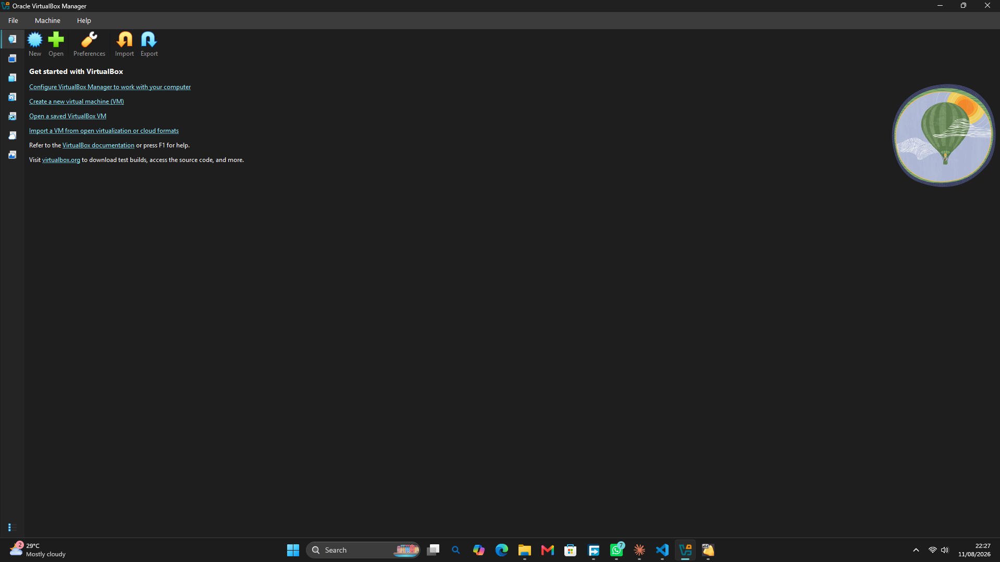

---

## Step 1. Create the NAT Network in VirtualBox

A dedicated NAT Network was created so both VMs stay in an isolated /24 network with internet access via NAT.

**Configuration used:**
```
Name: NatNetwork
IPv4 Prefix: 10.0.0.0/24
DHCP: Enabled
IPv6: Disabled
```

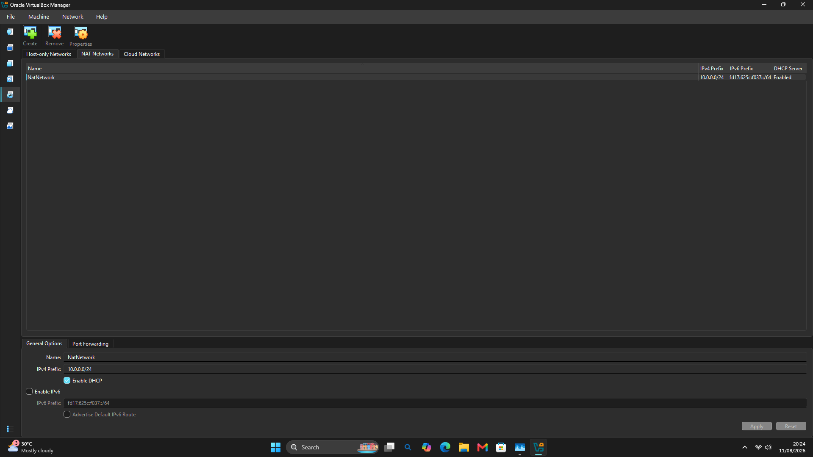

A NAT Network (rather than plain NAT) was chosen because it lets multiple VMs on the same network talk to each other directly, while each VM still gets outbound internet access — exactly what's needed for a lab where one VM will eventually attack/scan another.

---

## Step 2. Import Kali Linux into VirtualBox

Kali Linux 2026.2 was imported into VirtualBox and attached to `NatNetwork`.

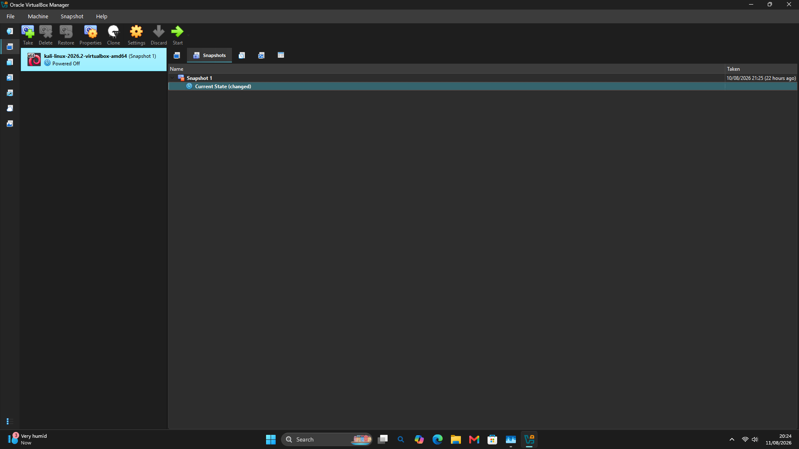

---

## Step 3. Boot and Verify Kali Linux

Kali was powered on and confirmed to boot correctly inside the NAT Network.

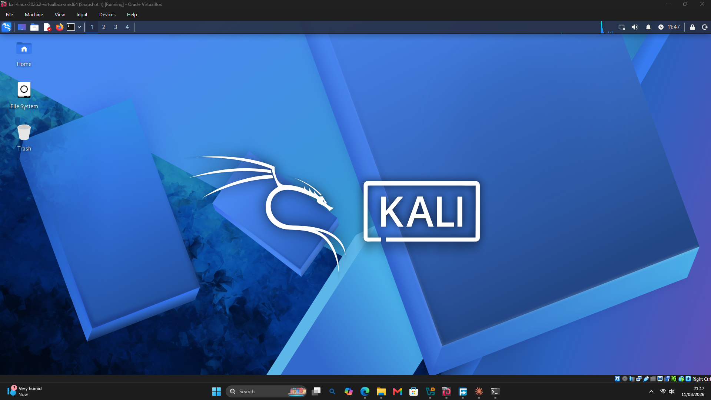

---

## Step 3.1. Configure a Static IP on Kali

Rather than relying on DHCP, Kali's network adapter was configured with a manual static IP inside the NatNetwork range, so it has a fixed, predictable address for every future lab exercise.

**Configuration used (Network Manager → Wired connection 1 → IPv4 Settings → Manual):**
```
Method: Manual
Address: 10.0.0.2
Netmask: 24
Gateway: 10.0.0.1
DNS servers: 8.8.8.8
```

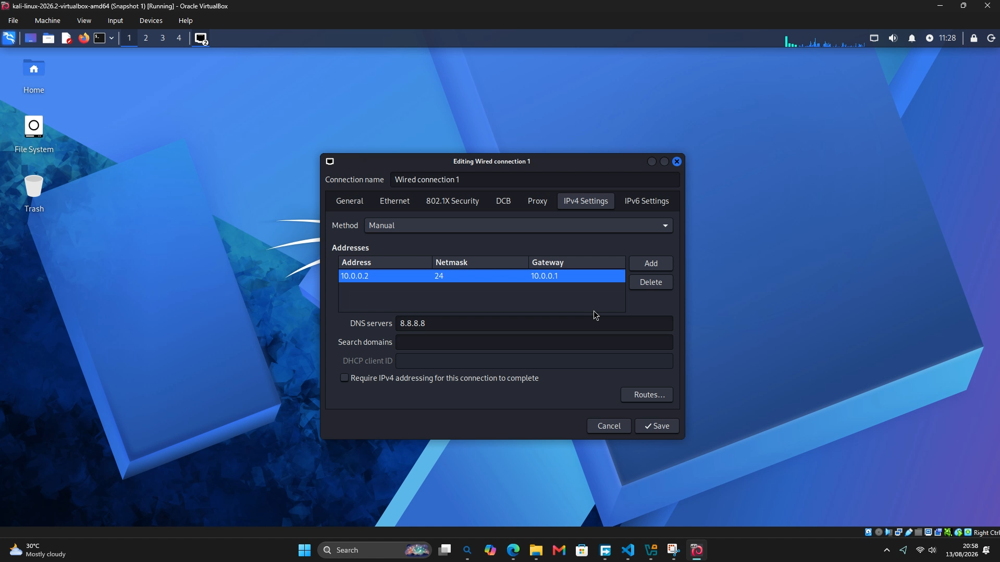

> 📝 **Note (Kali 2026.1+):** After applying a manual static IP, Kali lost internet connectivity after a VM restart. This is a known issue on Kali 2026.1 and higher, caused by NetworkManager's default IPv4 duplicate-address-detection (DAD) timeout. My instructor's fix, applied here, was:
> ```
> sudo nmcli connection modify "Wired connection 1" ipv4.dad-timeout 0
> ```
> Full details in the **Problems Encountered & Solutions** section below.

---

## Step 4. Download the Android-x86 Image

An Android-x86 9.0-R2 (Pie) 64-bit VirtualBox image was downloaded from osboxes.org as a `.7z` archive to use as a second, target-style VM in the lab.

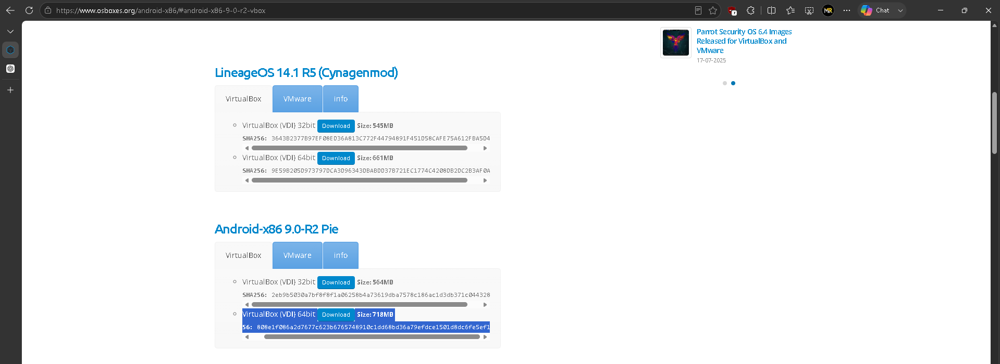

**Archive details after download:**

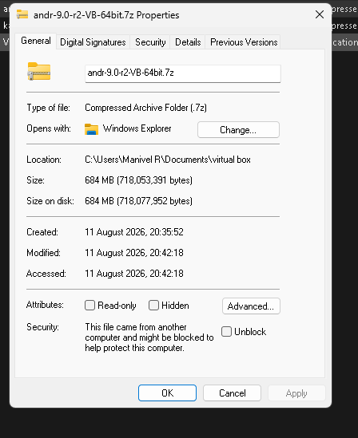

- File type: 7z compressed archive
- Size: 684 MB (718,053,391 bytes)

---

## Step 5. Extract the Android VDI

The archive was extracted using 7-Zip (`Right-click → 7-Zip → Extract Here`) to obtain the raw `.vdi` disk image, ready to attach to a new VM.

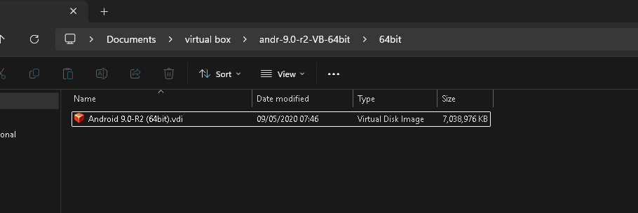

---

## Step 6. Import Android VM, Attach to NatNetwork, and Configure Static IP

A new VM was created in VirtualBox using the extracted VDI, attached to `NatNetwork`, and given a static IP inside the lab's address range so it has a predictable address for future exercises.

**Static IP configuration used inside Android:**
```
IP Address: 10.0.0.4
Gateway: 10.0.0.1
Network Prefix Length: 24
DNS 1: 8.8.8.8
DNS 2: 10.0.0.1
```

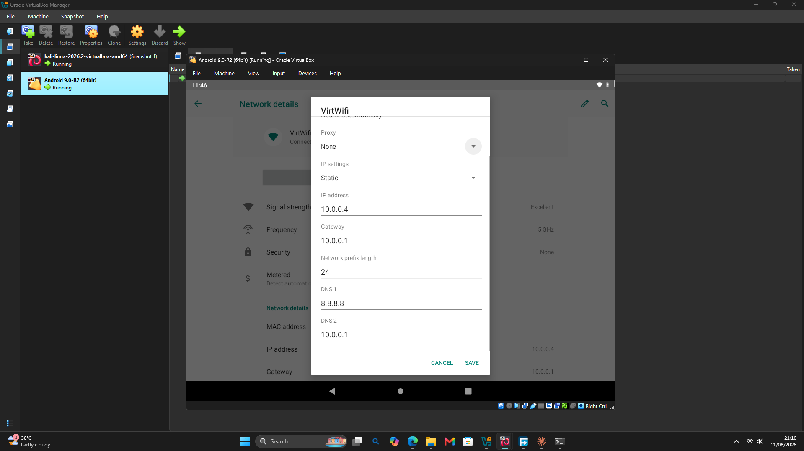

Both Kali and Android are shown running simultaneously inside the same NatNetwork, confirming both VMs are live on the isolated lab network.

---

## Step 7. Confirm Android Boots to a Usable Home Screen

The Android VM was verified to fully boot into its home screen with core apps (Gmail, Chrome, Play Store, Contacts, Gallery) available, confirming it's usable as a practice/target machine going forward.

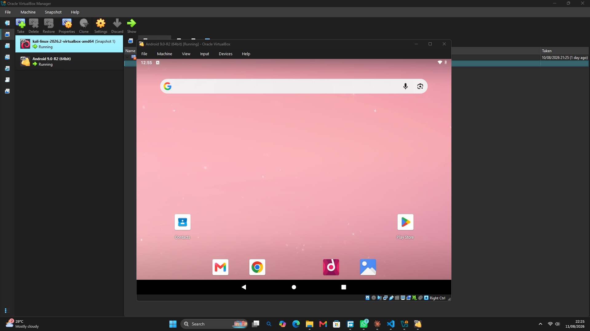

---

## Step 8. Take Final Snapshots of Both VMs

With both VMs configured and verified, a clean snapshot was taken of each — giving a known-good rollback point for both the attacker (Kali) and target (Android) machines before any future exercises begin.

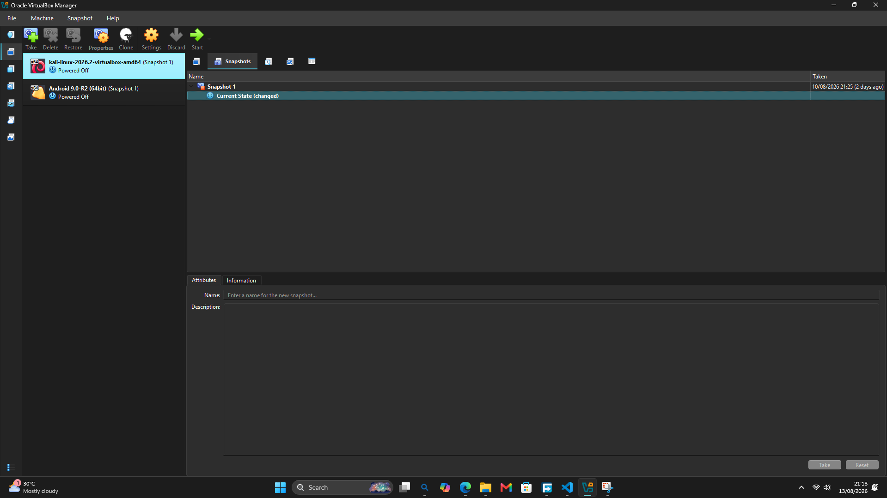

---

# 🔎 Lab Verification

Full connectivity and reconnaissance verification was performed from Kali against the Android target, confirming the lab is fully functional end-to-end:

| Test                        | Command                     | Result |
|-------------------------------|------------------------------|--------|
| Internet connectivity (via NAT) | `ping -c 4 google.com`      | ✅ Success — 4/4 packets received, 0% loss, avg ~145ms |
| VM-to-VM connectivity          | `ping -c 4 10.0.0.4` (Kali `10.0.0.2` → Android `10.0.0.4`) | ✅ Success — 4/4 packets received, 0% loss, avg ~1.05ms |
| Basic port scan of target       | `nmap 10.0.0.4`               | ✅ Success — host up, port 5555/tcp open (freeciv) |
| Service/version detection       | `nmap -sV 10.0.0.4`           | ✅ Success — identified port 5555 as **Android Debug Bridge (adb)**, device model VirtualBox, OS: Android |
| OS fingerprinting                | `nmap -O 10.0.0.4`            | ✅ Executed — confirms Nmap OS detection functions correctly against the target |

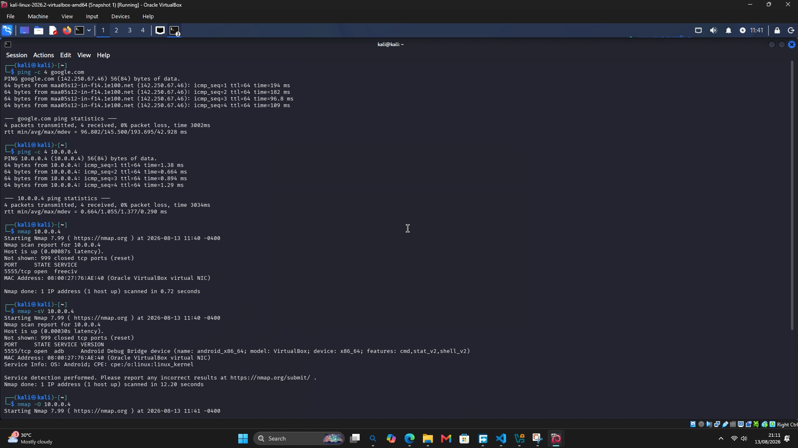

This confirms the full chain works end-to-end: Kali has internet access through NAT, can reach the Android VM directly on the isolated NatNetwork, and can successfully run reconnaissance tools (Nmap) against it proving the lab is ready for the offensive/defensive exercises planned in upcoming weeks.

---

# 🐞 Problems Encountered & Solutions

| Problem | Cause | Fix |
|---|---|---|
| After setting a manual static IP on Kali, the connection worked initially but broke after restarting the VM session | First (incorrect) assumption was an IP conflict with the NatNetwork DHCP pool, so I temporarily reassigned Kali from `10.0.0.2` to `10.0.0.10` this appeared to help, but wasn't the actual root cause | Watched my instructor's walkthrough video, which identified the real issue: Kali Linux 2026.1+ has a known problem where NetworkManager's default IPv4 duplicate-address-detection (DAD) timeout on the wired connection delays or silently breaks activation after a restart |
| Confirming the real fix | Once identified, the correct fix was to disable the DAD timeout directly via `nmcli` rather than work around it by changing IPs | Ran `sudo nmcli connection modify "Wired connection 1" ipv4.dad-timeout 0`, then reapplied Kali's intended static IP (`10.0.0.2`) connectivity has been stable across restarts since |
| Needed to confirm the fix actually worked, not just assume it | No error was thrown by VirtualBox or the OS when the connection silently failed | Ran a timeout-based `nmap` scan against the Android target from Kali after the fix to independently confirm reachability, rather than relying on `ping` alone |

**What I learned from this:** my first instinct (assume it's an IP conflict, change the address) fixed the symptom but not the cause a good reminder to keep digging rather than stop at the first thing that "seems" to work. The actual issue was NetworkManager-specific to newer Kali releases, and the fix ended up being a single `nmcli` setting rather than any network topology change at all.

---

# 💡 What I Learned

- **NAT Network vs plain NAT:** A NAT Network allows multiple VMs to see each other on the same virtual subnet while still getting outbound internet needed for a lab where VMs will interact.
- **Static IP addressing:** Giving both VMs fixed IPs makes them predictable, repeatable targets/attackers for future exercises, rather than chasing a changing DHCP-assigned address every session.
- **NetworkManager's DAD timeout on newer Kali releases:** Kali 2026.1+ can silently lose connectivity after a restart due to the default IPv4 duplicate-address-detection timeout worth checking `nmcli` settings before assuming it's a topology or DHCP conflict (see Problems section above).
- **Snapshots as a safety net:** Taking a clean snapshot of both VMs once they were fully configured and verified means I can always roll back to a known-good state before running any future exercise.
- **Archive/image handling:** Downloading and extracting a `.7z` VM image with 7-Zip and importing the raw `.vdi` into VirtualBox as a new machine.
- **Nmap as a verification tool, not just an attack tool:** Running `nmap -sV` against my own Android VM confirmed the lab network works correctly *and* gave me my first real look at how Nmap fingerprints a live device (it correctly identified the Android Debug Bridge service and device model).

---

# 🔐 Security & Ethical Use

This lab is intended strictly for personal learning inside this isolated NAT Network. It is not used against any system I don't own or have explicit permission to test.

---

# 🔗 Tools & Resources

- **VirtualBox:** https://virtualbox.org/wiki/Downloads
- **7-Zip:** https://www.7-zip.org/download.html
- **Kali Linux:** https://kali.org/get-kali
- **Android-x86 images:** https://www.osboxes.org/android-x86/

---

# 🎥 Video Walkthrough

A full video walkthrough of this lab setup is posted on LinkedIn:
🔗 [Watch here](https://www.linkedin.com/posts/mr-manivel-r_cybersecurity-ethicalhacking-internship-ugcPost-7493847178998714368-WtrL/?utm_source=share&utm_medium=member_desktop&rcm=ACoAAGDJA9sBzSi23edH7UWChoU_mcEMAARlJJ8)

---

# 🙏 Acknowledgements

Special thanks to [Networkwalks](https://www.linkedin.com/company/networkwalks/) and my instructor [Waqas Karim (CCIE)](https://www.linkedin.com/in/waqaskarim/) for the guidance throughout this lab.

---

# 👤 Author

**Manivel R**
Cybersecurity & Ethical Hacking Intern — Batch B082
**Networkwalks**

---

## 📌 Project Information

**Internship:** Cybersecurity Internship
**Week:** 01
**Project:** Cybersecurity & Pentesting Lab Setup
**Organization:** Networkwalks
